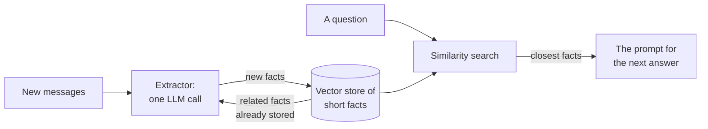

<!-- SERIES -->

*How LLM agents remember*, a series in nine parts:

1. [One conversation, five memory systems](/posts/2199/01/agent-memory-1-why/)
2. [A map of memory systems](/posts/2199/01/agent-memory-2-the-map/)
3. [What ChatGPT, Claude and Gemini ship](/posts/2199/01/agent-memory-3-frontier-assistants/)
4. [Textual memory: one profile, rewritten](/posts/2199/01/agent-memory-4-textual-memory/)
5. **Mem0: facts in a vector store** (this part)
6. [Zep and Graphiti: facts with dates, in a graph](/posts/2199/01/agent-memory-6-graphiti/)
7. [Letta: an agent that edits its own memory](/posts/2199/01/agent-memory-7-letta/)
8. [Honcho: a reasoner that works in the background](/posts/2199/01/agent-memory-8-honcho/)
9. [The experiment: 67 changed facts](/posts/2199/01/agent-memory-9-the-experiment/)

<!-- /SERIES -->

The running example of this series: in March a user tells an assistant they
are strictly vegetarian and have a severe peanut allergy; in July they say
they eat fish now, have moved to Kreuzberg, and that their sister Lena (no
shellfish) is coming with her partner Jonas (coeliac); in September they ask
the assistant to book dinner for the three of them
([part 1](/posts/2199/01/agent-memory-1-why/)). On the map of
[part 2](/posts/2199/01/agent-memory-2-the-map/), this part's system is a
pipeline that writes after each conversation, and a read path that selects.

## The idea

[Mem0][mem0] turns a conversation into a list of short, standalone facts
about the user and keeps them in a vector store. Writing is a model call: an
extractor reads the new messages, with the stored facts that look related in
view, and returns facts to keep. Reading is a similarity search: the question
is embedded and the closest facts come back.

It is the reference design of the whole field: the system almost every paper
since 2025 compares itself with, and the simplest one that is complete. It
is also the easiest to reproduce, because the paper writes down the whole
pipeline.

## What the paper describes

The paper's write path has two phases.

**Extraction.** For each new pair of messages (usually a user turn and the
assistant's reply), an LLM is shown a summary of the whole conversation, a
window of recent messages and the new pair, and asked for the salient facts
in the new pair only. The summary is refreshed by a separate, asynchronous
process, so extraction never waits for it (p. 3).

**Update.** For each candidate fact, the system retrieves the ten most similar
stored facts and hands all of them to the LLM through a tool call, which
chooses one of four operations: ADD a new memory, UPDATE an existing one with
complementary information, DELETE one the new fact contradicts, or NOOP. "Rather
than using a separate classifier, we leverage the LLM's reasoning capabilities
to directly select the appropriate operation" (p. 3–4). A graph variant,
Mem0ᵍ, stores entities and relations in a graph and, instead of deleting a
contradicted relation, marks it invalid "to enable temporal reasoning".

The paper's own numbers make the trade-off plain. On LoCoMo, full context
scores about 73% on the judge metric, Mem0 66.88% and Mem0ᵍ 68.44%, the graph
adding about a point and a half (p. 9–11). What Mem0 buys is speed and size:
a p95 latency of 1.44 seconds against about 17 for full context, a 92%
reduction, and a store of about 7,000 tokens per conversation (p. 11–14).

## The run

The [notebook][notebook] runs the real [`mem0ai`][mem0-repo] library with a
local Qdrant file as the vector store, and taps the two model handles it uses,
so every extraction call and every embedding call is printed. As everywhere
in this series, the model is `gemini-3.1-flash-lite` at temperature 0, with
`gemini-embedding-001` for embeddings.

### Writing

One `add()` call per session. Session 1 produced five facts in one model call:

| event | memory |
|---|---|
| ADD | User is planning a dinner in Berlin for their sister's visit during the week of October 12, 2026. |
| ADD | User has been a strict vegetarian for eight years. |
| ADD | User has a severe, anaphylactic peanut allergy. |
| ADD | User prefers Indian cuisine, specifically paneer dishes. |
| ADD | User has a budget of approximately 40 euros per person for the dinner. |

The turns are gone; what is stored are standalone sentences in the third
person, which is what lets a fact be found later by a question worded
differently. Each fact is a separate row, because different questions will
need them.

And the date is wrong. "Next week", said on 14 March, became "the week of
October 12, 2026". The prompt has an `Observation Date` slot, and the
open-source library fills it with the day the code runs, not the day of the
conversation. `add()` has a `timestamp` argument, and the library rejects it
as a feature of the hosted platform. Any history loaded after the fact, as
here, gets its relative dates resolved against the wrong day.

### Revising: what happens to the old fact

Session 2 says "pescatarian now, not vegetarian". The second `add()` produced
four facts, and the store then held nine:

| memory |
|---|
| User is planning a dinner in Berlin for their sister's visit during the week of October 12, 2026. |
| **User has been a strict vegetarian for eight years.** |
| User has a severe, anaphylactic peanut allergy. |
| User prefers Indian cuisine, specifically paneer dishes. |
| User has a budget of approximately 40 euros per person for the dinner. |
| **User transitioned from a strict vegetarian diet to a pescatarian diet in September 2026, meaning they now eat fish but no other meat.** |
| User relocated to the Kreuzberg neighborhood in May 2026 and prefers restaurant options within walking distance. |
| User's sister, Lena, is visiting in the autumn of 2026 and has a shellfish allergy. |
| User's sister Lena is traveling with her partner, Jonas, who has coeliac disease and requires a gluten-free diet. |

**The vegetarian line is still there.** Nothing updated it, deleted it or
marked it as replaced. This is the design of the current release, not a
misconfiguration; its extraction prompt says so in one line:

> Your sole operation is ADD: identify every piece of memorable information
> and produce self-contained, contextually rich factual statements.

The paper's four operations are gone. The release drops a new fact whose text
is identical to a stored one, and asks the model to link a new fact to related
ones by id, and that is all.

What saved this example is the extractor's phrasing. It did not write a flat
"user is pescatarian"; it wrote a fact about the change, "transitioned from a
strict vegetarian diet to a pescatarian diet", because the related facts
shown to it included the old vegetarian row. The new fact carries its
replacement inside its own sentence. That relied on the user wording the
reversal as a correction, and on the old row being among the related facts
shown to the extractor. And the date of the change is wrong again: "about a
month ago", said in July, became September, resolved against the day the
notebook ran.

### Reading

The question is embedded and searched, with `limit=6`. Nine facts came back:

| score | memory |
|--:|---|
| 0.740 | User's sister, Lena, is visiting in the autumn of 2026 and has a shellfish allergy. |
| 0.732 | User's sister Lena is traveling with her partner, Jonas, who has coeliac disease… |
| 0.725 | User is planning a dinner in Berlin for their sister's visit… |
| 0.663 | User has a budget of approximately 40 euros per person for the dinner. |
| 0.623 | User relocated to the Kreuzberg neighborhood in May 2026… |
| 0.616 | User prefers Indian cuisine, specifically paneer dishes. |
| 0.612 | User has a severe, anaphylactic peanut allergy. |
| 0.589 | User has been a strict vegetarian for eight years. |
| 0.588 | User transitioned from a strict vegetarian diet to a pescatarian diet… |

**`limit` is not a cap** in this release: it sizes an internal pool of
candidates, and the scored list comes back uncut. On a small store you get
everything, ranked, and deciding what goes into the prompt is left to the
caller.

Read the ranking as the list a model would be handed if the caller had cut it
at six, as it asked to. Both diet lines would be gone, and so would the peanut
allergy, in seventh place. The scores are close together, between 0.59 and
0.74, and nothing in a similarity score knows that an allergy must never be
left out. The wording of the question moves the ranking: for "what should I
cook tonight?", the top three are the cuisine, the budget and the dinner plan,
and the peanut allergy is not among them.

Handed all nine facts, the answer was built on the right constraints:
Kreuzberg, Indian food with paneer, the budget, the peanut allergy, Lena's
shellfish and Jonas's gluten. It did not act on the stale vegetarian line.
The reason is worth being exact about: the store was small enough that nothing
was cut, and the extractor had written the change into the new fact. With a
larger store and a real cut at six, the answer would have been written without
either diet line and without the allergy. The same question asked with no
memory at all produced an invented restaurant that had "confirmed" dietary
restrictions it was never told about.

### Cost

Two model calls for two sessions, one per `add()` however long the session
is, plus four embedding calls: one before each extraction to look up related
facts, one after to embed the new ones. One embedding call per question at
read time. This is the cheapest write path of the systems in this series
that write anything.

## What it does well, and how it fails

**It does well** at being cheap, small and inspectable. Every stored fact is
a sentence a person can read, correct or delete, and a write is one call.

**It fails** by never going back to a fact once it is written. In this
release the old fact and the new one are both in the store, equally
searchable, and whether the right one reaches the model depends on how the
extractor happened to phrase the new one and where the search happens to rank
it. Even the paper's design, with UPDATE and DELETE, can only resolve a
contradiction that the similarity search put in front of it: consistency is
checked against ten neighbours, so a conflict with the four-hundredth fact is
invisible by construction.

Independent measurements point the same way. In
[PersonaMem-v3][personamem-v3], Mem0 used an outdated stance in 51.4% of
answers about changed preferences, against 25.7% for a plain textual memory
(§4.3, p. 17), because "a topically relevant retrieved fact can remain too sticky
after expiry". In [Are We Ready For An Agent-Native Memory
System?][agent-native], after facts change, Mem0 scores 15.6 against 44.4 for
Zep (p. 9, Table 2). A superseded preference is about the same topic as the
one that replaced it, so a search that finds one finds the other.

And extraction is where facts are lost in the first place.
[HaluMem][halumem] scores each step of a memory pipeline separately and finds
that every system but one recalls fewer than 60% of the facts it should have
extracted, and that more than half of failed updates fail because the
original fact was never extracted (p. 11, Table 3). Mem0's score there drops
from 53.0% to 28.1% when the history grows to a million tokens.

## Relatives, and the attempts to fix the write

The extract-and-consolidate family is the largest in the literature. Three
variants change what one memory is:

- [SeCom][secom] stores topic segments instead of facts or turns, and finds
  that the unit matters: 71.57 for segments against 65.58 for single turns
  and 63.16 for whole sessions (p. 6, Table 1). Compressing the segments
  before retrieval acts as a denoiser rather than a loss: without it the score
  falls from 69.33 to 59.87 (p. 7, Table 2).
- [O-Mem][o-mem] keeps an explicit profile of user attributes next to the raw
  interactions and retrieves the attributes first, on the argument that
  similarity search drops information that is critical but not similar to the
  query, which describes the peanut allergy above exactly.
- [xMemory][xmemory] notes that a conversation is a highly redundant stream,
  so plain top-k returns near-duplicates; splitting history into small facts
  and grouping them raises F1 from 36.48 to 43.98 (p. 6, Table 1).

Two others replace the LLM's write decision. [Memory-R1][memory-r1] trains
Mem0's four operations with reinforcement learning, rewarded by whether
answers come out right, on only 152 question–answer pairs; on Llama-3.1-8B it
scores 62.74 against 45.68 for Mem0 (p. 5, Table 1), though the gain on
LongMemEval is small (55.4 against 54.2). [SAGE][sage] makes the decision
with a novelty test over the stored embeddings and asks a model only about
borderline cases, cutting write-side model calls from 3,269 to 1,889 at about
the same score (52.2 against 53.5): cheaper, not better.

## On real data

On the 67 LongMemEval knowledge-update questions of
[part 9](/posts/2199/01/agent-memory-9-the-experiment/), Mem0 2.2.1 answered
56 (84%, 95% interval 73–91%), at 10 model calls and $0.040 per question.
Each session was one `add()` call with the session's own date passed as the
observation date. The store held about 54 memories per question, a third of
them framed as advice the assistant had given ("User was recommended…").

Because the release only adds, the old value was still stored in 81% of
questions and still presented as current in 37%. That mostly did not matter:
when both values reached the answer, each with its date, the answer took the
newer one in 41 of 45 questions. The eleven wrong answers:

- **Four updates were never extracted**, each a revision mentioned in passing
  in a session about something else. In one, the cached reply for the session
  holds five memories about a sculpture (the sunset theme, natural materials,
  fabric, tools, found ocean objects) and none about the "10-12 hours" the user
  had put into it. The extraction prompt warns against exactly this: "Do not
  let a dominant topic cause you to miss secondary information."
- **Adding instead of replacing.** "Attended three sessions" and "attended
  five sessions" came back as two facts, and the answer added them: 3 + 5 = 8.
- **Dates by the day.** Two sessions on the same day gave two Instagram counts
  (1,250, then "close to 1300") the same date, and the answer could not tell
  which was later.
- One misread question, and three flawed questions that every system got
  wrong.

On the 25 questions run again with the whole history (about 48 sessions),
Mem0 stayed at 84%, and its cost rose 4.5 times, to $0.18 per question, while
what it put into the prompt stayed at about 900 tokens.

## When it is the right design

Mem0's design fits when the store will outgrow the prompt, when reads must
be fast and cheap, and when a user must be able to see and delete individual
facts. It needs three things it does not provide by itself: the conversation's
own dates passed in at write time, a decision about what to cut at read time
(and a rule that some facts, such as allergies, are never cut), and a way to
retire a fact that has been replaced. Without the third, a store of facts
about a person who changes accumulates both versions of them, and the reader
has to sort it out from the dates.

Next, [part 6](/posts/2199/01/agent-memory-6-graphiti/) gives every fact a
date range and a place in a graph, and closes the old fact explicitly:
Zep and Graphiti.

The notebook for this part is [mem0.ipynb][notebook]; the experiment's account
of every wrong answer is in [docs/findings/mem0.md][findings].

## References

<!-- REFS -->

Papers:

- Chhikara et al., [Mem0: Building Production-Ready AI Agents with Scalable Long-Term Memory][mem0] (2025)
- Jiang et al., [PersonaMem-v3: Toward Omni-Platform Personal Intelligence for Holistic User Understanding, Recommendation, and Agentic Tasks][personamem-v3] (2026)
- Zhou et al., [Are We Ready For An Agent-Native Memory System?][agent-native] (2026)
- Chen et al., [HaluMem: Evaluating Hallucinations in Memory Systems of Agents][halumem] (2025)
- Pan et al., [On Memory Construction and Retrieval for Personalized Conversational Agents][secom] (2025)
- Wang et al., [O-Mem: Omni Memory System for Personalized, Long Horizon, Self-Evolving Agents][o-mem] (2025)
- Hu et al., [Beyond RAG for Agent Memory: Retrieval by Decoupling and Aggregation][xmemory] (2026)
- Yan et al., [Memory-R1: Enhancing Large Language Model Agents to Manage and Utilize Memories via Reinforcement Learning][memory-r1] (2025)
- Wang et al., [SAGE: A Novelty Gate for Efficient Memory Evolution in Agentic LLMs][sage] (2026)

<!-- /REFS -->

Other sources:

- [mem0ai on GitHub][mem0-repo]

[mem0]: https://arxiv.org/abs/2504.19413
[personamem-v3]: https://arxiv.org/abs/2608.21381
[agent-native]: https://arxiv.org/abs/2606.24775
[halumem]: https://arxiv.org/abs/2511.03506
[secom]: https://arxiv.org/abs/2502.05589
[o-mem]: https://arxiv.org/abs/2511.13593
[xmemory]: https://arxiv.org/abs/2602.02007
[memory-r1]: https://arxiv.org/abs/2508.19828
[sage]: https://arxiv.org/abs/2605.30711
[mem0-repo]: https://github.com/mem0ai/mem0
[notebook]: https://github.com/anton-dergunov/agent-memory-eval/blob/main/notebooks/mem0.ipynb
[findings]: https://github.com/anton-dergunov/agent-memory-eval/blob/main/docs/findings/mem0.md

<!-- SERIES -->

---

[← Part 4: Textual memory: one profile, rewritten](/posts/2199/01/agent-memory-4-textual-memory/) · [Part 6: Zep and Graphiti: facts with dates, in a graph →](/posts/2199/01/agent-memory-6-graphiti/)

<!-- /SERIES -->
