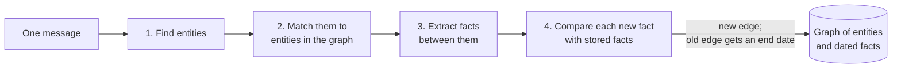

<!-- SERIES -->

*How LLM agents remember*, a series in nine parts:

1. [One conversation, five memory systems](/posts/2199/01/agent-memory-1-why/)
2. [A map of memory systems](/posts/2199/01/agent-memory-2-the-map/)
3. [What ChatGPT, Claude and Gemini ship](/posts/2199/01/agent-memory-3-frontier-assistants/)
4. [Textual memory: one profile, rewritten](/posts/2199/01/agent-memory-4-textual-memory/)
5. [Mem0: facts in a vector store](/posts/2199/01/agent-memory-5-mem0/)
6. **Zep and Graphiti: facts with dates, in a graph** (this part)
7. [Letta: an agent that edits its own memory](/posts/2199/01/agent-memory-7-letta/)
8. [Honcho: a reasoner that works in the background](/posts/2199/01/agent-memory-8-honcho/)
9. [The experiment: 67 changed facts](/posts/2199/01/agent-memory-9-the-experiment/)

<!-- /SERIES -->

The running example of this series: in March a user tells an assistant they
are strictly vegetarian and have a severe peanut allergy; in July they say
they eat fish now, have moved to Kreuzberg, and that their sister Lena (no
shellfish) is coming with her partner Jonas (coeliac); in September they ask
the assistant to book dinner for "my sister and her partner"
([part 1](/posts/2199/01/agent-memory-1-why/)). On the map of
[part 2](/posts/2199/01/agent-memory-2-the-map/), this part's system is a
pipeline that writes after every message, and a read path that selects.

## The idea

[Zep][zep] stores what a user said as a graph. The things mentioned (people,
places, a diet, an allergy) are nodes. Each fact is an edge between two nodes,
and every edge carries the dates between which it was true. When the user
changes their mind, the old edge is neither deleted nor overwritten: it gets
an end date. [Graphiti][graphiti-repo] is the open-source library at Zep's
core.

Of all the systems in this series, it is the only one that models time
explicitly, and that is why it is here.

## What the paper describes

The Zep paper builds three layers. An episode layer keeps every raw message
as the source of record. An entity layer holds the entities and the facts
between them; this is the layer that is searched. A community layer groups
strongly connected entities and summarises them, for broad questions.

**Writing.** Entities are extracted from the current message with the last
four messages as context, with a reflection pass to catch what was missed,
and the speaker is always an entity. Each new entity is resolved
against the existing ones by embedding similarity and full-text search, with
an LLM making the final call. Facts become edges, and a new fact is checked
for duplicates only against edges between the same two entities, which both
prevents wrong merges and keeps the comparison small. Communities are kept up
to date by label propagation, chosen over the Leiden algorithm because a new
node can simply join the community most of its neighbours belong to.

**Time.** Every edge carries four timestamps on two timelines: when the fact
became true and stopped being true in the world, and when the system learned
it and stopped believing it. Relative phrases ("two weeks ago") are resolved
against the message's own date when the fact is extracted. When a new edge
contradicts an old one whose validity overlaps it, the old edge's end date is
set to the new edge's start date. Nothing is deleted, so "what did I eat in
April?" can be answered as well as "what do I eat now?".

**Reading.** Three searches run side by side: cosine similarity, BM25 over the
text, and breadth-first search outward through the graph from relevant nodes.
The results are reranked (reciprocal rank fusion, maximal marginal relevance,
how often a fact was mentioned, distance in the graph, or a cross-encoder) and
rendered for the prompt as facts with their date ranges.

On LongMemEval the paper reports 71.2% against 60.2% for the whole history in
the prompt, with gpt-4o answering, and 1.6K tokens in the prompt instead of
115K (p. 7, Table 2). On MemGPT's own benchmark, DMR, it reports 94.8%
against 93.4% for MemGPT, and notes that the conversations there have only 60
messages; a full-conversation baseline scores 94.4% (p. 6, Table 1).

## The run

The [notebook][notebook] drives Graphiti's own prompts from short local code,
with no database, so that each of the four steps can be printed with its
prompt and reply. It leaves out entity summaries, attributes, communities and
the cross-encoder, and uses a small BM25 in place of the database's full-text
index. The constants that matter (similarity floors, the number of
candidates) are Graphiti's.

### Writing: what goes into the graph

The first message says the user is planning a dinner for their sister, has
been strictly vegetarian for eight years, and has a severe peanut allergy.
With Graphiti's default entity prompt, the model found three entities: Anton,
Anton's sister, and Berlin. No diet and no allergy.

The reason is in the prompt. It is written for a knowledge graph of named
things: it asks for entities that "could have their own Wikipedia article or
database entry", forbids abstract concepts, and ends with "when in doubt, do
NOT extract". A diet and an allergy are attributes of a person, not named
things, so a model that follows the instructions leaves them out, and a fact
needs two entities to exist. This is not a random failure; at temperature 0 it
happens on every run.

Graphiti's answer is custom entity types. Describing four kinds of thing that
matter here (Person, Place, Preference, HealthCondition) brought the diet and
the allergy in, with the same message and the same model. For a memory about
a person, that is the first thing to configure.

### Revising: the old fact gets an end date

Session 2 says "pescatarian now, not vegetarian". The fourth step showed the
model the new fact next to the stored facts that look related, and asked
which of them it duplicates and which it contradicts. The model named the
vegetarian fact as contradicted. Ordinary code then decided which fact ends
and when, from the dates: "vegetarian since 2018-03-14" now ends on
2026-06-20, the start of the pescatarian fact ("about a month ago", counted
back from 20 July).

This is the cleanest update in the series. The model judges that two facts
conflict; code decides what follows, and nothing is lost. "What was true in
April?" becomes a filter on dates, not a reconstruction.

The graph structure did real work twice in this step. The repeated peanut
allergy ("the peanut situation obviously hasn't changed") was caught as a
duplicate by looking up facts between the same two nodes. And "my sister
Lena" was matched to the node *Anton's sister* from March. Plain "Lena", two
messages later, was not: her name scored 0.595 against a floor of 0.6, so
there are now two nodes for the same person, and "Lena cannot eat shellfish"
hangs off the second one, connected to nothing.

### Reading: the closed fact comes back, the new one does not

The default search returned nine facts: those that share a word with the
question, plus those that score at least 0.6 on meaning. With this embedding
model every fact scores between 0.54 and 0.67, so the floor decides by the
third decimal:

| fact | cosine | returned |
|---|--:|---|
| vegetarian since 2018 (closed) | 0.608 | yes |
| pescatarian since June 2026 | 0.599 | no |
| Jonas has coeliac disease | 0.596 | no |

The write side did its job, and the read side handed back the old diet
without the new one. Storing an update correctly and delivering it are two
separate problems. The search does not filter out closed facts by default, so
the answer is given the closed one with its dates and has to work out that it
ended.

The answer built on that search looked complete and was not. It had the peanut
allergy, Lena's shellfish and the cuisine. It said nothing about what the user
eats, and nothing about gluten, so Jonas would have been booked into a
restaurant with no thought for coeliac disease. Kreuzberg, which is in the
graph, was not retrieved either.

### What the graph buys

"Jonas has coeliac disease" is the fact in this example that shares no words
with the question. Text search cannot find it. A walk along the graph from the
entities the question names finds it in two steps: sister → Jonas → coeliac.
That path exists only because "my sister Lena" and "Jonas" were matched to
nodes that were already there. This is the case a graph is for: the question
names one thing, and the answer is a fact about a different thing linked to
it, worded in a way that has nothing to do with the question.

For facts about the user, all of them one step from the user's node, the graph
adds little: a table of facts with a subject column and the same dates would
return the same rows. And the handling of time above needs dates, not a
graph. The walk is also not what `graphiti.search()` does by default. The
paper describes breadth-first search next to text and cosine search; the
library's default search uses the first two, and a walk has to be requested
through a search recipe, from starting nodes the application chooses. A read
tuned that way (current facts only, text search, then a walk) brought Jonas's
coeliac disease into the answer, and "fish is included" too, though from a
fact stored about the assistant's acknowledgement, "Noted, fish is in", not
from the pescatarian fact, which still ranked outside the ten.

### Cost

36 model calls and 24 embedding calls for ten short messages; Mem0 stored the
same two sessions with two. Every message is ingested separately, in order,
because step 4 reads what the previous message wrote. Step 4 is one call per
new fact, so the count grows with how much a message says. The entity prompt
alone is about 2,400 tokens each time, and the run read about 51,000 tokens to
store thirteen facts. The assistant's four messages cost 9 of the 36 calls and
produced one fact that nobody needed.

### What went wrong, and where

| What happened | Step | Cause |
|---|---|---|
| Diet and allergy not stored | find entities | the default prompt asks for named things |
| Two nodes for Lena | match entities | name similarity 0.595, under a 0.6 floor |
| Old diet returned, new diet not | read | the same 0.6 floor; closed facts not filtered |
| Coeliac fact not returned | read | text search only, no walk |
| A fact about what the assistant acknowledged | ingestion | every message is ingested |

Four of the five are settings: a prompt, two thresholds, a missing date
filter. The idea of dated edges held up. Nearly everything that decides
whether it works in practice is a threshold or a prompt that has to be set
for the application and for the embedding model in use. Zep's own experiments
used BGE-m3 embeddings; the 0.6 floors were not set for Gemini's.

## Three reasons for a graph, and the case against

Papers use a graph for three different reasons, and often conflate them.
Zep wants time. [HippoRAG][hipporag] wants multi-hop retrieval in one step: it
builds a schemaless graph of noun phrases from a fixed corpus, links near
synonyms, and spreads probability from the entities in a question with
Personalized PageRank, so a two-hop question costs one sparse computation
instead of one model call per hop. [A-MEM][a-mem] wants a store that
reorganises itself: each new note is linked to its neighbours, and the
neighbours are rewritten in light of it. The notebook's result fits this
split: the handling of time needed only the dates, and the graph earned its
place only on the multi-hop fact.

The evidence of 2026 is mostly against a graph as a default:

- [AgentMemBench][agentmembench] runs five strategies under one protocol. On
  LoCoMo, where the evidence lies many sessions back, graph memory retrieves
  almost nothing (Recall@5 at most 0.005), while a plain store of all turns
  searched by embedding reaches 0.573 (p. 10). The generator there is a small
  4-bit model, so read the ordering, not the levels.
- [A-TMA][a-tma] measures Graphiti/Zep's temporal F1 on LoCoMo at 0.0295, and
  names the failure "ghost memory": old, current and transitional versions of
  a fact retrieved together and mixed in the answer. Its overlay labels each
  retrieved fact as current, historical or transitional and raises the score
  to 0.1705 (p. 11, Table 3). Storing dated edges is not the same as
  answering from the right one.
- [Mem0's paper][mem0] adds that its graph variant gains about a point and a
  half over plain Mem0, and reports Zep's graph at more than 600,000 tokens
  per LoCoMo conversation, with new memories usable only hours later (p. 14).
  That is a competitor's measurement.

In its favour, after facts change, the independent study [Are We Ready For An
Agent-Native Memory System?][agent-native] ranks Zep first, at 44.4, against
20.0 for long context and 15.6 for Mem0 (p. 9, Table 2). Updating is exactly
what the dated edges are for.

## On real data

The experiment in [part 9](/posts/2199/01/agent-memory-9-the-experiment/)
runs the real library, graphiti-core 0.31.1 on Neo4j, with every setting at
its default. Its first run scored 18%. The second scored 82%. Nothing changed
between them but how the conversation was handed over.

In the first run, each session was cut into episodes of up to 8,000
characters. Graphiti's extraction prompts are written for one message from a
named speaker, and it adds the previous ten episodes as context, so each
prompt carried 60,000–80,000 characters, mostly the assistant's long answers,
and the model returned two or three entities. In a traced example the update
"I just finished my 5th project since starting painting classes" was in the
prompt; the model extracted `assistant` and `bold colors`, so no fact about
projects existed to update. Fed one message per episode, as Graphiti's own
examples do, the same sentence produced the entities `user`, `painting
project` and `painting classes` and the edge "The user has completed their 5th
project since they began attending painting classes". Nothing failed loudly
in the broken run. It was cheap, and it was wrong.

The working run answered 55 of 67 (82%, 95% interval 71–89%), in the same band
as Mem0 and Honcho, at **720 model calls and $0.64 per question**, by far the
most expensive system in the experiment: thirty times textual memory, and
more than three hundred times plain retrieval over raw turns, which scored
97%. Three quarters of the facts it extracted came from the assistant's
messages ("The assistant recommends using hand soap to clean black Converse"),
and each of them got its own contradiction check.

When its design worked, it worked well: in the 26 questions where the new fact
reached the answer and the old one reached it marked superseded, the answer
was right every time. Its twelve failures:

- **Six updates were never extracted**, all revisions mentioned in passing:
  "which brings my total species count to 32" produced facts about sunflower
  seeds, suet and a Northern Flicker, but no count.
- **One was extracted in a form that did not contradict**: a change to 6 pm
  became "a gym commitment at 6:00 pm on Tuesday", next to the unchanged 7 pm
  on other days.
- **One was closed the wrong way round, by the dates.** Graphiti dates a fact
  by when it became true. Paris ("we just went there as a family last
  month"), said in May, became valid from April 1; "a recent family trip to Hawaii"
  became valid from the day it was mentioned, May 26. Graphiti closed Paris as
  superseded by Hawaii, and the answer to "Where did I go on my most recent
  family trip?" followed the graph. Every other system answered Paris.
- One old value was stored twice and only one copy was closed; three answers
  had both values and still computed, added or hedged wrongly.

## When a graph earns its cost

A dated graph is the right design when the questions need history ("where did
she live last year?"), when the answer is reached through linked entities
rather than through the words of the question, and when an explicit,
auditable record of what changed and when is worth paying for at every
message. It is not a general accuracy upgrade. Its cost is paid on every
message whether or not the workload has any multi-hop questions, and it is
fragile in the way the notebook shows: the prompts, the thresholds and the
way messages are fed in decide what it stores, and nothing reports when they
are wrong. If what you need is "the newest value wins", dates on plain facts
do that.

Next, [part 7](/posts/2199/01/agent-memory-7-letta/) hands the writing to the
answering agent itself: Letta.

The notebook for this part is [zep-graphiti.ipynb][notebook]; the experiment's
account of every wrong answer is in [docs/findings/graphiti.md][findings].

## References

<!-- REFS -->

Papers:

- Rasmussen et al., [Zep: A Temporal Knowledge Graph Architecture for Agent Memory][zep] (2025)
- Gutiérrez et al., [HippoRAG: Neurobiologically Inspired Long-Term Memory for Large Language Models][hipporag] (2024)
- Xu et al., [A-MEM: Agentic Memory for LLM Agents][a-mem] (2025)
- Cherif, [AgentMemBench: A Systematic Benchmark for Evaluating Long-Term Memory Management Strategies in Conversational AI Agents][agentmembench] (2026)
- Shi et al., [A-TMA: Decoupling State-Aware Memory Failures in Long-Term Agent Memory][a-tma] (2026)
- Chhikara et al., [Mem0: Building Production-Ready AI Agents with Scalable Long-Term Memory][mem0] (2025)
- Zhou et al., [Are We Ready For An Agent-Native Memory System?][agent-native] (2026)

<!-- /REFS -->

Other sources:

- [Graphiti on GitHub][graphiti-repo]

[zep]: https://arxiv.org/abs/2501.13956
[mem0]: https://arxiv.org/abs/2504.19413
[hipporag]: https://arxiv.org/abs/2405.14831
[a-mem]: https://arxiv.org/abs/2502.12110
[agentmembench]: https://arxiv.org/abs/2608.00009
[a-tma]: https://arxiv.org/abs/2607.01935
[agent-native]: https://arxiv.org/abs/2606.24775
[graphiti-repo]: https://github.com/getzep/graphiti
[notebook]: https://github.com/anton-dergunov/agent-memory-eval/blob/main/notebooks/zep-graphiti.ipynb
[findings]: https://github.com/anton-dergunov/agent-memory-eval/blob/main/docs/findings/graphiti.md

<!-- SERIES -->

---

[← Part 5: Mem0: facts in a vector store](/posts/2199/01/agent-memory-5-mem0/) · [Part 7: Letta: an agent that edits its own memory →](/posts/2199/01/agent-memory-7-letta/)

<!-- /SERIES -->
