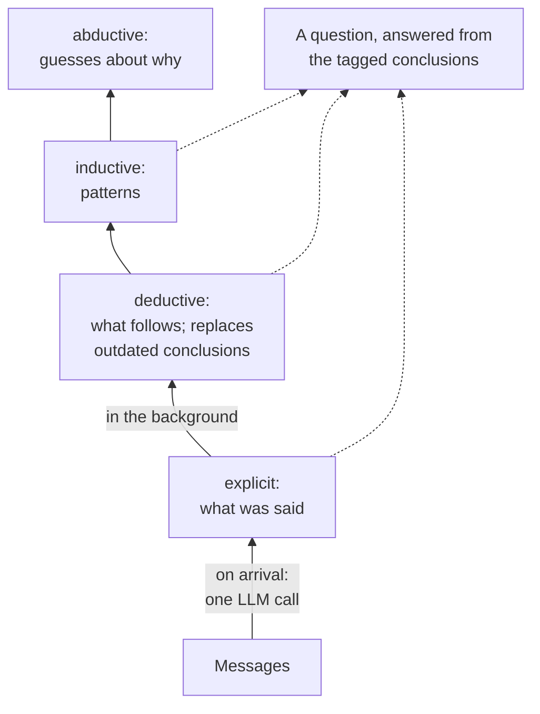

<!-- SERIES -->

*How LLM agents remember*, a series in nine parts:

1. [One conversation, five memory systems](/posts/2199/01/agent-memory-1-why/)
2. [A map of memory systems](/posts/2199/01/agent-memory-2-the-map/)
3. [What ChatGPT, Claude and Gemini ship](/posts/2199/01/agent-memory-3-frontier-assistants/)
4. [Textual memory: one profile, rewritten](/posts/2199/01/agent-memory-4-textual-memory/)
5. [Mem0: facts in a vector store](/posts/2199/01/agent-memory-5-mem0/)
6. [Zep and Graphiti: facts with dates, in a graph](/posts/2199/01/agent-memory-6-graphiti/)
7. [Letta: an agent that edits its own memory](/posts/2199/01/agent-memory-7-letta/)
8. **Honcho: a reasoner that works in the background** (this part)
9. [The experiment: 67 changed facts](/posts/2199/01/agent-memory-9-the-experiment/)

<!-- /SERIES -->

The running example of this series: in March a user tells an assistant they
are strictly vegetarian and have a severe peanut allergy; in July they say
they eat fish now, have moved to Kreuzberg, and that their sister Lena (no
shellfish) is coming with her partner Jonas (coeliac); in September they ask
the assistant to book dinner for the three of them
([part 1](/posts/2199/01/agent-memory-1-why/)). On the map of
[part 2](/posts/2199/01/agent-memory-2-the-map/), this part's system is a
background process that writes, with a read path that selects.

## The idea

[Honcho][honcho-repo], from Plastic Labs, treats memory as reasoning about a
person. Every stored item is a *conclusion* at a stated level of certainty,
and it records the conclusions it was drawn from.

| Level | Means | Example |
|---|---|---|
| explicit | they said it | *Anton is vegetarian* |
| deductive | it follows necessarily | *Anton does not eat chicken* |
| inductive | a pattern, likely true | *Anton plans meals carefully around constraints* |
| abductive | a guess about why | *Anton may have had a bad allergic reaction in the past* |



What was said is extracted when the messages arrive. The higher levels are
worked out later, by a background process Honcho calls the *dreamer*. Because
each conclusion keeps its premises, when one of them stops being true the
system can find everything that was resting on it. Of the systems in this
series it is the only one that stores inferences, not just statements, and
that is why it is here.

## Where it comes from

The pattern of a background pass that writes higher-level conclusions back
into memory goes back to [Generative Agents][generative-agents], whose
characters periodically "reflected" on their memory stream and stored the
reflections next to the observations. Honcho's levels make that reflection
typed, and its links make it traceable. Plastic Labs' earlier paper on
[violation of expectation][voe] supplies a second idea that the current code
uses: reason first about the observations that most surprised the model's
prediction of the user, instead of about all of them.

Honcho has no paper of its own, so what it does is read from its repository.
On the current main branch (checked in October 2026), the server's levels are
`explicit`, `deductive`, `inductive` and `contradiction`; explicit conclusions
"are extracted directly from messages; the others are derived during
dreaming". The dreamer's specialists are agents that search the store with
tools for up to twelve steps. A deduction specialist writes logical
implications and knowledge updates and deletes outdated observations; an
induction specialist writes patterns, with a confidence set by how many
sources support them; and a scheduler ranks observations by how surprising
they are and starts with those. The abductive level, the one that would write
hypotheses, has been announced and is not implemented: a code comment names
it as an example of a level that could be added.

## The run

The [notebook][notebook] is the least faithful re-implementation in the
series, and says so: the prompts are mine, written from Honcho's published
level definitions, and each background specialist is one model call over the
whole store rather than an agent with tools. It implements the abductive level
anyway, to see what it produces. Every model call is `gemini-3.1-flash-lite` at
temperature 0.

### Writing: the explicit level

Extraction came out about the same as Mem0's in
[part 5](/posts/2199/01/agent-memory-5-mem0/): short standalone facts, one per
row. Two differences carry everything that follows. Each row is tagged with
its level, and each derived row lists its premises. Given the session's date,
the extractor also turned "eight years" into "since March 2018".

### Deduction: what follows

The deduction pass, run over the whole store after session 1, added the
consequences of what was said, some useful and some not. "Anton does not
consume meat or fish" followed from the vegetarian row. "Anton consumes dairy
products", drawn from enjoying paneer, is close to the line between a
deduction and a guess. "Lena is a person", stored later as a deduction, is
true and useless. Much of the prompt is spent telling the model what not to
put at this level, because a model that labels a plausible reading as
deductive has turned a guess into a fact.

### The level rule, enforced by code

"A premise must rank below its conclusion" can be a guideline that someone
has to remember. It can also be a check that code runs, and in the notebook it
is eleven lines. Planting a hypothesis and then a deduction drawn from it
produced:

```text
REJECTED  d10 <- a9   ABDUCTIVE premise for a DEDUCTIVE conclusion
```

That does not stop the model from writing a bad hypothesis; nothing does. It
stops a bad hypothesis from becoming the basis for something certain. And
because every link goes strictly down the levels, following links from any
conclusion always ends.

### Revising: replace the fact, and what rested on it

Session 2 says "pescatarian now, not vegetarian". The explicit level recorded
it and did not resolve anything, which is right: that level records what was
said, so the store briefly held both diets, as Mem0's did. Then deduction ran
over the whole store and was allowed to replace rows. Two were replaced: the
vegetarian fact, by an update that states the change with its date, and
"Anton does not consume meat or fish", which had been deduced from it.

The second replacement is the part only premises make possible. Anything
concluded from a premise that is no longer true has lost its support, whether
or not it looks wrong, and because every conclusion lists its premises, the
set of conclusions affected by a withdrawn fact can be computed. In a list of
facts with no links there is nothing to follow.

### Induction and abduction

The pattern level produced reasonable patterns with unreliable confidence
labels: both came back "high" from four premises, against a rule in the
prompt that says three to four premises is "medium". Confidence that the code
computes from the premise count would be more honest than confidence the model
writes.

The hypothesis level is where the design carries its risk. Its one hypothesis
read:

> Anton is actively researching and curating a list of safe, inclusive
> restaurants in Kreuzberg to host a dinner for Lena and Jonas in autumn 2026,
> necessitating his recent shift to a pescatarian diet to better align with
> potential shared dining options that accommodate his own peanut allergy,
> Lena's shellfish allergy, and Jonas's coeliac disease.

Read it as a stranger reading it about you. It is fluent and plausible. It
also says that the user started eating fish *in order to* make a dinner easier
to book. Nobody said that; he started eating fish in June and mentioned the
visit in July. There is real information here that a list of facts leaves
unused, it cannot be checked from what is stored, and the level tag is the
only thing between this sentence and a fact. The prompt asked each hypothesis
to name what would confirm it ("check: Ask Anton if he is currently looking
for restaurant recommendations in Kreuzberg…"), which is a cheap safeguard: a
hypothesis that says how to test it can be tested in the next session instead
of quietly becoming something the system believes. It is perhaps also the
reason the level is not in Honcho's repository yet.

### Reading

Honcho's read path, which it calls *dialectic*, answers a question about the
user in plain language, written from the stored conclusions, rather than
returning a list of rows. The notebook's version hands every live conclusion,
tagged with its level, to one call. The answer had the peanut allergy, Lena's
shellfish, gluten-free for Jonas, the budget, Indian food and Kreuzberg; it
did not state the diet.

The vegetarian row was not in what the model was given. It had been
replaced, so it did not compete with the fact that replaced it, and that did
not depend on how anything was worded or where a search ranked it. But all
twenty-three live lines were handed over because they fit; on a real profile
something has to choose which conclusions to pass on, and that choice brings
back the retrieval problems of the other parts.

### Cost

| call | tokens in | tokens out |
|---|--:|--:|
| explicit, session 1 | 374 | 121 |
| deductive | 461 | 182 |
| explicit, session 2 | 421 | 236 |
| deductive | 888 | 340 |
| inductive | 907 | 195 |
| abductive | 959 | 193 |
| answer (dialectic) | 533 | 111 |

Seven calls, against two for Mem0. The totals mean little at this size; the
first column is the point. Extraction reads the session, so it stays flat.
Every reasoning level reads the store, so its input grows with the profile:
the second deduction read almost twice what the first did. Each pass reads
everything and adds to what the next pass will read, and nothing limits how
much is derived. That is why Honcho runs the reasoning in the background, not
on every turn, and why its scheduler starts from the most surprising
observations instead of all of them.

## What it does well, and how it fails

**It does well** at the update. The stale fact stops competing with its
replacement, whatever the wording, and what was concluded from the stale fact
can be found and withdrawn. The level tag costs one field and is what makes
replacement safe, an explanation possible ("why do you think that?" is a walk
down the premises, ending in things the user said), and hedging correct.

**It fails** by inventing. A background reasoner over a person's history
produces sentences about that person that nobody said, and the higher the
level, the more plausible and the less checkable they are. [Belief
Memory][belief-memory] names the failure that follows from storing a single
conclusion: the agent acts on it and never revisits the alternatives, so each
action reinforces it. Its fix is to keep several candidate conclusions with
probabilities, and it reaches 58.66 on ALFWorld against 39.81 for Mem0 (p. 7,
Table 2). And a store of inferences is a privacy question before it is an
accuracy question; [the memory-security survey][security-survey] collects the
ways persistent memory can be poisoned once and exploited later.

## On real data

The experiment in [part 9](/posts/2199/01/agent-memory-9-the-experiment/)
runs the real Honcho server, v3.3.0, self-hosted (API, deriver, Postgres,
Redis), with every model role on the same small model. One store was built
per question and read two ways: through the dialectic agent (`chat`), and
through the representation endpoint (`repr`), which returns the conclusions
themselves, each with its timestamp, and makes no model call.

| Read path | correct | 95% interval | tokens given to the answer |
|---|--:|---|--:|
| dialectic chat | 58 of 67 (87%) | 76–93% | 77 |
| representation | 62 of 67 (93%) | 84–97% | 935 |

The deriver wrote about 111 explicit conclusions per question, stamped to the
minute; one scheduled dream added about two deductive and two inductive ones.
It did not close old conclusions: the old value was still presented as
current in 64% of questions, the highest of any system. Both read paths
therefore left the choice to the answering model, and handed it over in
different shapes.

The representation path gave it dated lines ("[2023-05-20 10:21:00] user has
a to-watch list consisting of 20 titles."), and the answer took the newer one
in 51 of 53 questions where both values were delivered. The dialectic path
gave it a summary, and when the dialectic agent found two values it often wrote
the conflict up as a question: "there is conflicting information (20 titles on
May 20 vs. 25 titles on May 22) with no clarification on which figure is
correct". The answer then declined too. Five of the chat path's nine wrong
answers are refusals of this kind, and they are most of the six-point gap
between two read paths over the same store. The amount delivered differed by
a factor of twelve; the cheaper summary lost answers that the raw lines kept.

The other failures were ordinary: one revision never derived (the user later
says they *have* a spare screwdriver), and one answer that picked the lens
called "recent acquisition" over the "new 70-200mm zoom lens".

One limit belongs here rather than in part 9. LongMemEval's knowledge-update
questions state each fact once and revise it once. Nothing is repeated across
sessions, so a system whose value is in inferring patterns from repetition, as
Honcho's is, has nothing to work on. This experiment tests whether Honcho
handles a changed fact, not whether its reasoning levels pay off.

## When a background reasoner earns its cost

A background reasoner earns its cost when the answers depend on things the
user implies more than states (habits, patterns, why they want what they
want), when the store must say how sure it is of each line, and when retracting
a fact must retract what was built on it. Its write cost grows with the
profile, so it belongs off the request path, and it needs a rule for when to
stop deriving. For "remember what I told you, and use the newest version", it
is more machinery than the problem needs, and its read path matters as much as
its store: here, the same conclusions scored 87% or 93% depending on whether
they reached the answer as a summary or as dated lines.

Next, [part 9](/posts/2199/01/agent-memory-9-the-experiment/) runs all of the
systems on 67 real knowledge-update questions, with the baselines first.

The notebook for this part is [honcho.ipynb][notebook]; the experiment's account
of every wrong answer is in [docs/findings/honcho.md][findings].

## References

<!-- REFS -->

Papers:

- Park et al., [Generative Agents: Interactive Simulacra of Human Behavior][generative-agents] (2023)
- Leer et al., [Violation of Expectation via Metacognitive Prompting Reduces Theory of Mind Prediction Error in Large Language Models][voe] (2023)
- Liao et al., [Belief Memory: Agent Memory Under Partial Observability][belief-memory] (2026)
- Lin et al., [A Survey on Long-Term Memory Security in LLM Agents: Attacks, Defenses, and Governance Across the Memory Lifecycle][security-survey] (2026)

<!-- /REFS -->

Other sources:

- [Honcho on GitHub][honcho-repo]

[generative-agents]: https://arxiv.org/abs/2304.03442
[voe]: https://arxiv.org/abs/2310.06983
[belief-memory]: https://arxiv.org/abs/2605.05583
[security-survey]: https://arxiv.org/abs/2604.16548
[honcho-repo]: https://github.com/plastic-labs/honcho
[notebook]: https://github.com/anton-dergunov/agent-memory-eval/blob/main/notebooks/honcho.ipynb
[findings]: https://github.com/anton-dergunov/agent-memory-eval/blob/main/docs/findings/honcho.md

<!-- SERIES -->

---

[← Part 7: Letta: an agent that edits its own memory](/posts/2199/01/agent-memory-7-letta/) · [Part 9: The experiment: 67 changed facts →](/posts/2199/01/agent-memory-9-the-experiment/)

<!-- /SERIES -->
